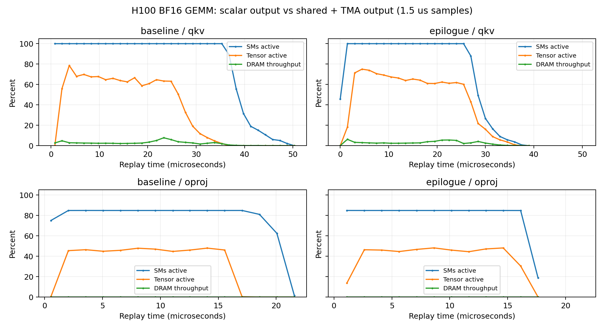

# Agent DSL 的 GEMM 写回优化：H100 验证结果

**已采纳。只改 AveLang DSL，单层 chain 从87.931降至77.035 μs，耗时降低12.4%。**
DSL由`attn_lowering` agent编写；协调者提供上一轮profiling反馈，并独立执行正确性、
测时、sanitizer及本轮NCU分析。硬件lowering未修改。

GPU：NVIDIA H100 NVL，132 SM；BF16输入/输出、FP32 GEMM累加。
工作负载为B16、T26、H8、KV2、D256、hidden2048的单层attention mixer。
两段GEMM的(M,N,K)分别为(416,5120,2048)和(416,2048,2048)，不是整个模型e2e。
AveLang提交`5f349c594ad510ad6b90d0e1ca310c0d47aa9ed1`，CUDA13.2、LLVM23；
其余环境见[harness/environment.json](harness/environment.json)。

## 同次预约的普通CUDA graph测时

每个graph重复100次调用，20轮随机交错测量，固定随机种子0；使用同一份输入。
编译、分配、Python提交不计入GPU时间。表中是中位数，单位μs。
原始样本、p10/p90均保留在[analysis/timing_all.json](analysis/timing_all.json)。

| 项目 | 旧Ave | 新Ave | CuTe | Ave耗时降低 |
|---|---:|---:|---:|---:|
| QKV projection | 38.269 | 30.050 | 17.518 | 21.5% |
| Output projection | 15.690 | 12.532 | 8.183 | 20.1% |
| 单层chain | 87.931 | **77.035** | 35.800 | **12.4%** |

chain的p10–p90：旧87.272–88.107、新76.359–77.144、CuTe35.271–36.058 μs。
新Ave比旧版快1.141倍，但仍是CuTe的2.152倍耗时。
非GEMM阶段未改；7次launch不变。阶段独立测量之和不必等于chain时间。

## 改了什么

旧版按WGMMA accumulator线程布局逐元素写BF16 global memory。新版使用现有DSL接口：

1. 将FP32 accumulator两两转换为BF16x2。
2. 用`stmatrix_m8n8_x4_b16`重排到128B-swizzled共享内存。
3. 各写线程执行proxy fence，再由128-thread named barrier会合。
4. tid0发出两次64列的TMA store，commit并等待完整写回。

复用B输入stage0的16 KiB；动态shared始终为73984 bytes。
最后输入stage0对应kt30，kt30/31均已完成full-barrier和WGMMA等待，producer
只有32次迭代，重用前再同步全部consumer，因此无剩余输入写入/读取。
最后一块使用独立32×64输出descriptor，仅写有效32行。

tile仍是64×128，输入仍是3-stage TMA，WGMMA主循环未变。
AST检查确认仅`linear_native`改变；没有改attention精度、融合方式或编译器。
源码和SHA见[harness/source_manifest.json](harness/source_manifest.json)。
新版SHA256为`b3197d3bf1880691826e59b6d99642a0fc072ac28df23bdca66b9d8ce394f1f7`，
已原样推广至[scripts默认实现](../../scripts/attn_fusion_native/native_candidate.py)。

## NCU与实际指令证据

新采集旧版/新版两段GEMM的full+PM及source报告。
指标来自`ncu_report` API；[分析脚本](analysis/analyze.py)、
[指标表](analysis/comparison.json)、[SASS](analysis/epilogue_qkv.sass)均保留。
下表NCU耗时来自base clocks/replay，不能与上面的普通graph耗时混用。

| 指标 | 旧QKV | 新QKV | 旧OProj | 新OProj |
|---|---:|---:|---:|---:|
| NCU时间μs | 52.704 | 40.096 | 23.648 | 19.776 |
| Tensor active / elapsed | 31.91% | **42.50%** | 28.55% | **34.60%** |
| achieved occupancy | 16.25% | 16.56% | 7.70% | 7.81% |
| registers/thread | 93 | 90 | 93 | 90 |
| NCU shared bytes（含系统开销） | 75008 | 75008 | 75008 | 75008 |
| 动态`STG.E.U16` | 66560 | 0 | 26624 | 0 |
| 动态`STSM.16.M88.4` | 0 | 8960 | 0 | 3584 |
| 动态`UTMASTG.2D` | 0 | 560 | 0 | 224 |
| 动态`HGMMA.64x128x16` | 143360 | 143360 | 57344 | 57344 |

不同指令操作的粒度不同，不能把指令数量比值当成加速比。
旧版scalar global store每sector只用8/32 bytes；新版消除了这一LSU写回路径。
新版LSU store计数为0，**不表示没有global写流量，也不能把该路径的0 bytes/sector
解释成TMA利用率**；写回已转到TMA引擎。

资源/负载：每CTA仍是160线程；QKV280个CTA、OProj112个CTA。shared限制仍为3个CTA/SM，
寄存器限制仍为4个CTA/SM；没有spill。OProj的112个CTA少于132个SM，部分SM空闲，
其低occupancy不能靠省3个register解决。

调度/stall：新版QKV source样本中long-scoreboard为45.37%，barrier为31.55%；
热点仍在mbarrier轮询和`WARPGROUP.DEPBAR.LE 0`。新版OProj的barrier样本为47.09%，
首要热点仍是WGMMA等待。比例受总样本构成影响，不代表对应wall-time增加；不能把
剩余延迟全部归因于新加的epilogue barrier。详见`analysis/stalls_*.json`。

内存：这组暖缓存测量中，QKV读DRAM吞吐仅为峰值的约1.4–1.7%，OProj更低，
不支持“HBM带宽饱和”的判断。所有版本无register spill。

时间线如下：旧版Tensor工作结束后的SM活跃区段更长；新版明显缩短了这一段。
该图支持写回尾部缩短的判断，不提供纯epilogue的精确计时。



## 正确性与同步检查

- 全部7个specialization离线编译、ptxas汇编通过；默认入口推广后也重新编译通过。
- seed0/17/123、更新输入/权重/RoPE表后的graph回放、因果前缀、batch隔离、零输入通过。
- 对照输入下，两个GEMM的全部BF16输出与旧版逐位一致；特别检查最后32行，输出后的
  32行guard不变。chain的attended/output也与旧版逐位一致。
- memcheck/synccheck：0 errors；racecheck：0 hazards / 0 errors / 0 warnings。
- cosine≥0.9999、relative L2≤0.02阈值不变。测试最差非零cosine为0.9999998140494218。
- 本分支仍无artifact invariant模块，未将这些测试冒充静态不变量证明。

原始数值记录：[correctness.json](analysis/correctness.json)；sanitizer日志在`logs/`。

## 测量限制和剩余工作

NCU使用`--cache-control none --clock-control base`。两项L2派生hit-rate超过100%，
原因是跨pass计数不一致；已记录在[measurement_warnings.json](analysis/measurement_warnings.json)，
未作为有效命中率使用。PM采样间隔1.5 μs，不同metric可能来自不同replay；
source stall样本比例不是wall-time占比。

这次只验证了输出阶段的优化。剩余差距优先调查固定shape的tile/warpgroup安排及
主循环等待，结合小grid和现有WGMMA stall热点做整体调度实验。此前仅改wait-group
重叠草稿未带来收益，不能假设单改等待就能解决。Attention仍是原SIMT实现，
其Tensor Core化/融合属于后续独立实验，不计入本次收益。

## 复跑与系统队列

GPU队列**3679**（完整正确性＋三方timing）和**3681**（三种sanitizer＋NCU）均退出0。
CPU编译、报告解析和绘图不使用GPU；没有私有队列或绕过等待。

```bash
# 当前默认实现：自动通过系统GPU队列
NATIVE_RESULTS="$PWD/.repro/attn-fusion-native-epilogue-results" scripts/attn_fusion_native/run.sh test
scripts/attn_fusion_native/run.sh memcheck
scripts/attn_fusion_native/run.sh synccheck
scripts/attn_fusion_native/run.sh racecheck

# 冻结三方源码：将复跑结果写到新文件
profile/attn-native-epilogue-h100-20261102/harness/run.sh timing \
  --output /profile/analysis/timing_repeat.json

# CPU解析已有NCU报告
python3 profile/attn-native-epilogue-h100-20261102/analysis/analyze.py
```

NCU报告位于`reports/{full,source}_{baseline,epilogue}.ncu-rep`。
重复采集新的profiling实验应创建新run目录，避免覆盖本轮证据。
