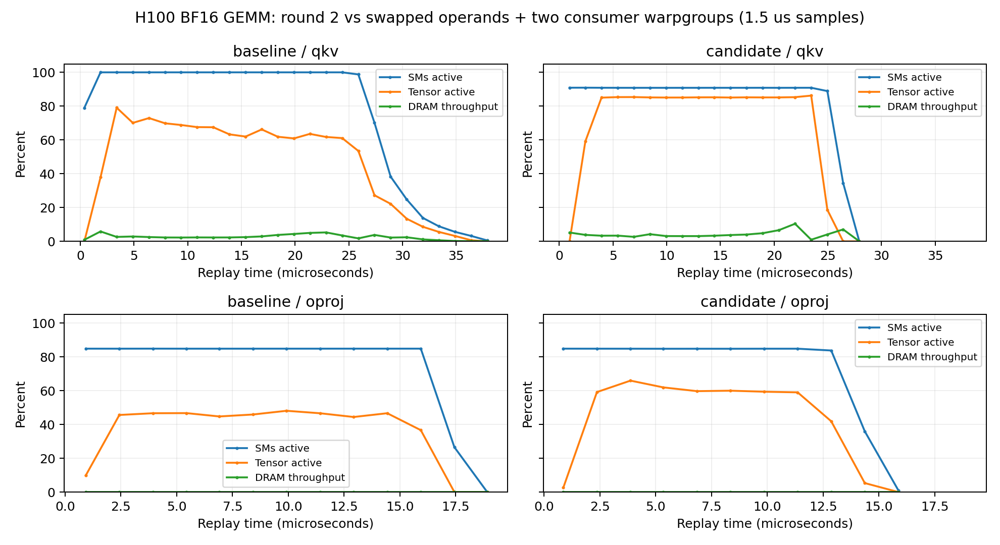

# Agent DSL 固定shape GEMM优化：round 3

**已采纳。H100上，B16/T26单层chain从77.179降到66.572 μs，耗时降低13.7%。**
主要收益来自QKV：30.444→19.551 μs。DSL由`attn_lowering` agent修改，协调者负责
独立reference、系统GPU队列、正确性、测时和profiling。没有修改硬件lowering。

GPU：NVIDIA H100 NVL，132 SM；BF16输入/输出、FP32 GEMM累加。
工作负载B16/T26/H8/KV2/D256/hidden2048；两段GEMM的(M,N,K)为
(416,5120,2048)和(416,2048,2048)。这是单层attention mixer，不是整模型e2e。
AveLang提交`5f349c594ad510ad6b90d0e1ca310c0d47aa9ed1`，CUDA13.2、LLVM23；
其余环境见[harness/environment.json](harness/environment.json)。

## 同次预约的完整chain选择

每个CUDA graph重复100次调用，20轮随机交错，随机种子0；使用同一份输入。
编译、分配、Python提交不计入GPU时间。表中为中位数，单位μs。
原始样本和数值结果保存在[analysis/timing_selection.json](analysis/timing_selection.json)。

| 实现 | chain | p10–p90 | QKV单独测量 | OProj单独测量 |
|---|---:|---:|---:|---:|
| Round 2 | 77.179 | 76.798–77.973 | 30.444 | 12.685 |
| 新QKV＋旧O | 67.170 | 66.881–67.666 | 19.565 | 12.637 |
| **新QKV＋双warp-group O（选中）** | **66.572** | **66.336–67.624** | **19.551** | 12.913 |
| CuTe | 35.874 | 35.438–36.236 | 17.505 | 8.190 |

选中版本比round 2快1.159倍，但仍是CuTe的1.856倍耗时。
新O在20个配对轮次中18次使chain更快，配对节省中位数0.578 μs。
这支持其在本次完整chain中的小幅收益，**不支持独立OProj更快的结论**；
单独测量的OProj中位数没有改善。阶段之和不必等于chain时间。
选择记录见[analysis/selection.json](analysis/selection.json)；其中bootstrap区间只是
同一次测量样本的描述性重采样，不是多次独立实验的置信保证。

## 有界配置实验与被拒绝的方案

首次筛选共4个配置；在两个单warp-group O方案无收益后，仅追加1个同tile、
双warp-group O方案。没有无界autotuning。

| 投影配置 | 首轮中位μs | 后续中位μs | 结论 |
|---|---:|---:|---|
| 旧QKV | 30.085 | 31.037 | 对照 |
| QKV 160tokens×128channels，wait1 | 20.600 | 21.219 | 选中 |
| 同QKV，wait0 | 20.453 | 21.275 | 与wait1分布重叠 |
| 旧O | 13.908 | 14.591 | 对照 |
| O 128tokens×64channels，单WG | 14.365 | — | 未见收益 |
| O 96tokens×64channels，单WG | 15.902 | — | 未见收益 |
| O 64tokens×128channels，双WG | — | 13.102 | 再以完整chain确认 |

两次筛选分别为20和40轮、100次调用/graph。原始数据见
[sweep.json](analysis/sweep.json)、[sweep_followup.json](analysis/sweep_followup.json)。
不同测量中的缓存/时钟状态会影响结果，尤其是独立OProj；本轮最终选择依据是上面的
同次完整chain比较。QKV wait0/wait1两轮分布均重叠，不能单独归功于wait1。

## DSL改变及同步约束

交换GEMM操作数：物理计算`W[channel,K] × A[token,K]^T`，把token维放在WGMMA的N维；
用transposed stmatrix恢复[token,channel]布局，再TMA写回。

- QKV：160tokens×128channels，每CTA两个m64n160 consumer warp-groups；
  4-stage K64 TMA，grid40×3=120 CTA，288线程/CTA。原round 2为280 CTA、160线程。
- OProj：64tokens×128channels，两个m64n64 consumer warp-groups；4-stage TMA，
  grid16×7=112 CTA、288线程。其CTA数、有效输出和token padding与round 2一致。
- 两个WG共享token tile，每stage的empty barrier count为2；wait_group1后各WG
  释放前一stage，最终wait_group0后释放最后stage。
- 所有256个consumer结束后会合，才重用weight共享arena作为输出scratch。
  每WG独占自己的输出区域，各写线程proxy fence后会合，由其lane0发TMA store；
  full completion和最终CTA同步后退出。
- QKV的最后96行、OProj的最后32行分别使用对应的tail descriptor。
- 非GEMM DSL函数AST不变；attention精度、BF16舍入、FP32累加和7次launch不变。

QKV的token tile数量从7降到3，同一个weight tile的重复加载次数随之减少；两个WG
同时复用一份token tile。更大的tile和计算组组织一起改变了访存/调度，实验没有
将这些因素逐个分离，不能把全部收益归到其中一个因素。

默认[native_candidate.py](../../scripts/attn_fusion_native/native_candidate.py)与
round3_candidate字节一致，SHA256：
`c25bacf5405cec557f226d442e7a6cd4c4fd5bf518fb2a48650ee2e26712fd71`。
源码清单见[harness/source_manifest.json](harness/source_manifest.json)。
首次筛选源码`round3_sweep_candidate.py`、后续/选择源码`round3_followup_candidate.py`
和最终源码均独立保留。选择时在host端显式绑定两种O配置；最终源码只把默认O选择器
设为测出的胜出配置，所有函数AST与该次测量相同。

## NCU与实际指令

本轮重新采集旧版/新版两段GEMM的full+PM和source报告，用`ncu_report` API解析。
指标见[comparison.json](analysis/comparison.json)，脚本见[analyze.py](analysis/analyze.py)。
NCU使用base clocks/replay，下面的耗时不能与普通CUDA graph耗时混用。

| 指标 | 旧QKV | 新QKV | 旧O | 新O |
|---|---:|---:|---:|---:|
| NCU时间μs | 40.160 | 29.376 | 19.712 | 17.728 |
| Tensor active / elapsed | 42.92% | **63.92%** | 34.64% | 40.54% |
| achieved occupancy | 16.57% | 14.06% | 7.81% | 14.05% |
| registers/thread | 90 | 106 | 90 | 58 |
| NCU shared bytes（含系统开销） | 75008 | 148736 | 75008 | 99584 |
| 动态TMA store数 | 560 | 240 | 224 | 224 |

新QKV为`HGMMA.64x160x16`、新O为`HGMMA.64x64x16`；两者均使用
`STSM.16.MT88.4`和`UTMASTG.2D`，没有spill或scalar global output store。
不同WGMMA宽度的指令数不能直接当作等量工作或加速比。

资源/负载：新QKV的shared和register限制均为1个CTA/SM，120个CTA少于132 SM；
其occupancy下降但Tensor活跃显著提高，收益并非来自更高occupancy。
新O的shared限制为2个CTA/SM、register限制为3个CTA/SM；112个CTA仍留下一些SM空闲。
这两个grid都没有完全填满132个SM，不宜宣称完全解决负载不均。

Stall/调度：QKV long-scoreboard source样本由43.65%降到11.15%，热点从输入mbarrier
轮询转为`WARPGROUP.DEPBAR.LE 1`（barrier样本40.81%）。O的barrier样本由47.03%降至8.18%，
但仍有30.39% long-scoreboard，热点在输入等待。样本比例不是wall-time比例。
原始源级热点和SASS保存在`analysis/stalls_*.json`及`analysis/*_{qkv,oproj}.sass`。

内存：这组暖缓存NCU测量中，QKV读DRAM吞吐约峰值的1.78%→3.49%，O更低，
没有HBM带宽饱和的证据。全程无register spill。普通graph测量与NCU下的O收益不同，
不能用NCU较短的O耗时替代前面的正常运行结果。

PM时间线显示新QKV的Tensor工作平台更高、更集中；新O也提高了Tensor活跃平台。
采样间隔1.5 μs，不同metric可能来自不同replay，因此不据此计算精确流水阶段耗时。



## 正确性、限制与剩余差距

- 11个specialization离线编译/ptxas通过；推广后的默认入口和QKV前端诊断也通过。
- 所有试验GEMM在对照输入下与round 2逐位一致；所有有效行、NaN预填和guard检查通过。
- 最终默认配置通过seed0/17/123、更新输入/权重/RoPE表后的CUDA graph回放、
  因果前缀、batch隔离和零输入测试；数值阈值不变。
- 最终默认配置的memcheck/synccheck：0 errors；racecheck：0 hazards / 0 errors / 0 warnings。
- 本分支仍无artifact invariant模块，以上不是静态不变量证明。

一次L2派生hit-rate超过100%，已记入[measurement_warnings.json](analysis/measurement_warnings.json)，
未作为有效命中率使用。`--cache-control none`的多pass统计不完全同步。

QKV已经接近CuTe，剩余整层差距主要落在未改的unpack、Q norm/RoPE、SIMT attention/gate
路径，以及OProj。新默认attention/gate单独约16.90 μs，另有Q norm约4.08、unpack约4.21 μs；
这些仍有后续优化空间。本次未调整这些阶段，也未放宽softmax概率或BF16舍入约束。

## 系统队列与复跑

GPU队列3691、3699、3701、3705分别执行首次筛选、后续筛选、整层选择、最终验证/NCU，
全部退出0。CPU编译、报告解析和绘图不使用GPU，没有绕过或嵌套系统队列。

```bash
# 当前默认实现
scripts/attn_fusion_native/run.sh cpu
scripts/attn_fusion_native/run.sh test
scripts/attn_fusion_native/run.sh memcheck
scripts/attn_fusion_native/run.sh synccheck
scripts/attn_fusion_native/run.sh racecheck

# 冻结最终实现、round2、CuTe三方测时（写新文件）
profile/attn-native-round3-h100-20261102/harness/run.sh timing \
  --output /profile/analysis/timing_repeat.json

# 复现四方O配置选择：使用当时冻结的host默认配置
profile/attn-native-round3-h100-20261102/harness/run.sh timing --compare-o \
  --candidate-module round3_followup_candidate --output /profile/analysis/selection_repeat.json

# 解析已有NCU报告（CPU）
python3 profile/attn-native-round3-h100-20261102/analysis/analyze.py
```

NCU报告位于`reports/{full,source}_{baseline,candidate}.ncu-rep`；完整验证与sanitizer日志
在`logs/`，机器可读汇总在[scripts/validation.json](../../scripts/attn_fusion_native/validation.json)。
新的profiling采集应建立新run目录，不覆盖本轮报告。
