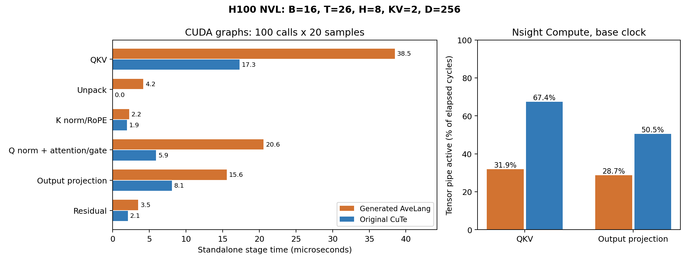
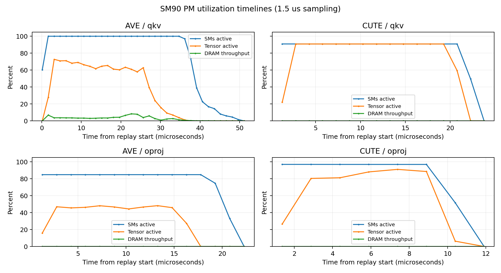

# AveLang / CuTe 单层 attention：代码与 profiling 对照

**结论：差距主要落在 GEMM 的分块、流水线和写回方式，以及 attention 的计算与数据复用方式。**
提供的 backend 确实生成了 TMA/WGMMA；当前生成 kernel 的实现仍明显不同于原 CuTe。
没有发现寄存器 spill，也没有把 Python/JIT 编译时间计入 GPU 时延。

## 0. 测量范围与方法

- 2026-11-02，NVIDIA H100 NVL，132 SM；Nsight Compute **2026.2.1**。
- 固定 **B=16、T=26、H=8、KV=2、D=256、hidden=2048**，单层 mixer，不是整模型 e2e。
- AveLang 使用 `5f349c594ad510ad6b90d0e1ca310c0d47aa9ed1` 的 native Hopper backend。
- 原 benchmark 的4个 CuTe阶段＋`torch.add`，对比生成版7个 AveLang阶段。
- 源码冻结在 [harness/sources](harness/sources)，身份记录在
  [source_manifest.json](harness/source_manifest.json)。本次未更改生产 kernel 或 compiler。
- 两版使用同一组输入/权重，关闭 TF32，先通过独立 reference 检查，再测时。
- 普通测时：CUDA graph，每图100次调用、20个交错样本，不含编译/分配/Python提交。
- NCU：`--set full --section PmSampling --section PmSampling_WarpStates`，另采集
  `--set source --section SourceCounters`；只捕获 `cudaProfilerStart/Stop` 内的目标调用。
- NCU 使用基础频率、`--cache-control none`，以观察预热后的路径。**NCU时长不与普通
  CUDA graph时长混算。** 原始报告保留了缓存重放与缺失CTC指标的警告，见第5节。
- CuTe启用 `CUTE_DSL_LINEINFO=1` 并保存PTX/cubin。AveLang在原PTX中仅添加
  `.file/.loc`，检查去掉这些指令后文本完全一致，再用原CUDA driver JIT加
  `CU_JIT_GENERATE_LINE_INFO`。源映射落到PTX行，不冒充Python逐行映射。
- GPU系统队列：**3666**（数值/对照计时）、**3667**（两版full＋source采集），均退出0。
  等待参数的独立诊断实验使用 **3671**，同样退出0。

## 1. 时延差距在哪里

下表为普通CUDA graph测时，单位μs。Q相关阶段按相同工作内容合并比较。

| 工作 | AveLang | 原 CuTe/torch | 差额 |
|---|---:|---:|---:|
| QKV投影 | 38.480 | 17.290 | +21.190 |
| 独立unpack | 4.158 | 无独立阶段 | +4.158 |
| K norm/RoPE | 2.237 | 1.932 | +0.305 |
| Q norm/RoPE＋attention＋gate | 20.591 | 5.924 | +14.666 |
| 输出投影 | 15.581 | 8.078 | +7.503 |
| residual | 3.492 | 2.077 | +1.415 |
| **完整单层链** | **87.680** | **35.696** | **+51.984** |

两个GEMM的独立测时差额合计约28.7μs，Q路径约14.7μs，是主要检查对象。
各阶段独立回放的缓存状态与整链不同，**不把这些差额视为严格可加的因果分解**。



## 2. GEMM：有WGMMA，但计算组织和收尾不同

### 2.1 实际机器码与发射规模

| 项目 | Ave QKV | CuTe QKV | Ave OProj | CuTe OProj |
|---|---:|---:|---:|---:|
| CTA数量 | 280 | 120 | 112 | 128 |
| threads/CTA | 160 | 384 | 160 | 256 |
| registers/thread | 93 | 98 | 93 | 78 |
| NCU shared bytes/CTA | 75008 | 178176 | 75008 | 227328 |
| theoretical occupancy | 23.44% | 18.75% | 23.44% | 12.50% |
| achieved occupancy | 16.25% | 13.51% | 7.71% | 7.61% |
| Tensor pipe active / elapsed | **31.91%** | **67.39%** | **28.73%** | **50.50%** |
| NCU时长，基础频率 | 52.224μs | 25.312μs | 23.648μs | 13.184μs |

生成版两个GEMM都采用64 token×128 channel、K64、三阶段缓冲。CuTe交换AB，
让token处于WGMMA的N维：QKV使用`HGMMA.64x144x16`、两个计算warpgroup；
OProj使用`HGMMA.64x104x16`，K128、五阶段缓冲。原版按两个具体shape分别调过参数。

Ave OProj的112个CTA少于132个SM，最多覆盖112个SM；原版是128个CTA。
但**occupancy并不能单独解释差距**：Ave QKV的achieved occupancy反而更高，
Tensor Core活跃比例却不到CuTe的一半。应优化每个活跃warp的数据复用和有效产出，
而不是仅增加blocks或寄存器约束。

机器码证据：[Ave QKV](analysis/ave_qkv.sass)、[CuTe QKV](analysis/cute_qkv.sass)、
[Ave OProj](analysis/ave_oproj.sass)、[CuTe OProj](analysis/cute_oproj.sass)。

### 2.2 生成版每个K64组等待清空，原版保留流水

Ave机器码的主循环是四条`HGMMA.64x128x16`后跟
`WARPGROUP.DEPBAR.LE ... 0x0`；CuTe QKV主循环使用`... 0x1`，收尾才等待0。

SourceCounters显示：

- Ave QKV：long-scoreboard占采样 **47.6%**，barrier **26.4%**；两个最大热点为
  mbarrier等待循环的分支和`WARPGROUP.DEPBAR.LE 0`（分别560、559个采样）。
- Ave OProj：barrier占 **41.5%**；`WARPGROUP.DEPBAR.LE 0`单点413个采样。
- CuTe OProj：barrier占 **4.4%**；其主要等待位置在TMA阶段就绪路径。

这些是采样占比，不是可直接相减的kernel时间百分比。NCU的通用“CTA barrier”说明
不能代替具体SASS定位；这里的重要热点包含WGMMA group等待。

此前单独改成保留一个WGMMA group的草稿，并未降低整链延迟。这说明等待位置是
信号，但不能据此承诺“把0改成1就能追平”；应连同tile、stage和数据搬运一起设计。

### 2.3 写回方式是明确的效率差距

Ave输出路径直接从累加器转换后，逐个BF16元素写global：

```text
HGMMA.64x128x16.F32.BF16 ...
WARPGROUP.DEPBAR.LE gsb0, 0x0
...
STG.E.U16 ...
STG.E.U16 ...
```

CuTe先转置写入共享内存，再整块TMA写回：

```text
HGMMA.64x144x16.F32.BF16 ...
...
STSM.16.MT88.4 ...
UTMASTG.2D ...
```

NCU在两个Ave GEMM上都测到global store每个32-byte sector只使用 **8 bytes**。
QKV有 **399360 / 532480 = 75%** 的多余sector请求；这是片段布局到行主序输出
没有充分合并写入的直接证据。QKV执行 **66560条`STG.E.U16`**；原版主要以
**240条`UTMASTG.2D`**完成写回。两种指令的粒度不同，不能把数量比例当成加速比。

NCU对store访问模式给出的启发式改善估计为QKV **28.8%**、OProj **26.0%**，
仅作为kernel内的排查优先级，不能相加或当作整链收益承诺。

### 2.4 PM时间线显示生成版收尾更长



CuTe QKV的Tensor管线在主要计算段约90%活跃；Ave约60–73%，随后逐渐下降。
Ave有更长的“Tensor Core已停止、SM仍活跃”的尾段，与标量转换/写回和CTA收尾相符。
按“最后Tensor>1%采样到最后SM>10%采样”的粗指标，QKV为Ave约7.5μs、CuTe约1.5μs；
OProj为Ave约4.5μs、CuTe在1.5μs采样分辨率下未分开。**这些不是精确epilogue计时**。

此预热场景中DRAM read吞吐约为峰值的0–1.9%，没有HBM带宽饱和的证据。
两版均未观察到local-memory spill。寄存器数量本身不是已证实的主要原因。

## 3. Attention：不同的计算与数据复用路线

生成版的 [SASS](analysis/ave_attention.sass) 没有HMMA/HGMMA矩阵乘指令，主要为
`LDG.E.U16`、`FFMA`、`FMUL/FADD`、`SHFL`、`MUFU`。
每个query/head一个warp，逐key更新softmax和8个FP32累加器。

CuTe的 [SASS](analysis/cute_attention.sass) 包含`LDGSTS.E.128`、矩阵shared-load、
`HMMA.16816.F32.BF16`和`STG.E.128`；一个CTA处理16个query，并在块内复用K/V，
同时融合Q norm、RoPE和gate。

| 证据 | Ave attention | CuTe融合attention |
|---|---:|---:|
| CTA×threads | 3328×32 | 256×128 |
| 执行的SASS warp指令，汇总计数 | 4739072 | 1416960 |
| `LDG.E.U16` | **772096** | 无此路径 |
| `HMMA.16816.F32.BF16` | **0** | **32768** |
| long-scoreboard采样 | **46.6%** | **10.8%** |
| NCU时长 | 26.208μs | 9.888μs |

Ave的global loads已经合并得较好，但每次只加载一个BF16，调用次数多且有依赖链；
这是“请求/依赖延迟”问题，不等于HBM带宽耗尽。编译器已把Q的重复加载移出key循环，
不能声称它每个key都重读Q；反复发生的是K/V的逐query访问。

还有一个必须说明的精度条件：原CuTe在softmax后把P转为BF16，再使用Tensor Core做
P×V（[源码](harness/sources/cute/qnorm_attention.py)，`sp`写入和后续`cute.gemm`）。
本轮任务描述要求P保持FP32，因此生成版选择SIMT的PV。这是我们给agent的保守约束，
**不能把这一部分差距全部算成编译器质量差异**。不过QK本身可用BF16输入、FP32累加
的Tensor Core，不需要新增P舍入；它目前也尚未分块实现。

两版都通过benchmark容差，但精度并不相同：本轮attended relative-L2为
Ave **0.000570**、CuTe **0.002634**。不能不说明这个差别就拿吞吐做等价实现比较。

生成版另有独立unpack和Q norm/RoPE，分别约4.16、4.04μs。融合有机会消除两个
独立launch及中间读写，但不能把它们的全部耗时直接当成净收益，因为norm计算仍需完成。

## 4. 对lowering等待策略的控制实验

原生backend的`LowerMBarrierWaitToRawPtxPass`主动将等待改成不带timeout的raw PTX
循环，DSL传入的`10000000`不进入最终指令。CuTe使用带该参数的指令，SASS有
`NANOSLEEP.SYNCS`。这是实际发现的codegen策略差异，不是仅看函数名猜测。

在[独立诊断run](../attn-native-wait-ablation-h100-20261102/REPORT.md)中，只给两处
PTX等待补上`10000000`，生产源码不变。正确性通过，新增SASS睡眠路径也已确认。

| 普通graph测时 | 原等待 | 补timeout |
|---|---:|---:|
| Ave单层chain | 87.680μs | 87.764μs |
| Ave QKV | 38.480μs | 38.030μs |
| 同场CuTe chain控制 | 35.696μs | 35.975μs |

分布重叠，没有可测的整链收益。因此**不能把缺少timeout称作本例的主要慢因**，
也没有据此修改生产lowering。

## 5. 可信范围与测量限制

- 普通CUDA graph计时、静态PTX/SASS、指令计数和采样热点共同支持以上结论。
- NCU锁基础频率且单次launch重放，时长明显高于graph热跑；不能将两组时间混算。
- `--cache-control none`保留预热路径，但跨pass缓存不完全一致。4个派生L2命中率出现
  >100%的不可物理解读值，完整记录在[measurement_warnings.json](analysis/measurement_warnings.json)。
  本报告不使用这些命中率作为依据，不截断成100%。
- SM90上6个CTC指标不可用，与本单GPU计算无关；没有把缺失指标当成0。
- PM间隔1.5μs；CuTe attention只有约6个有效采样点，不能据此断言细粒度流水线行为。
  PM各metric可能来自不同重放，不能把不同曲线的瞬时值当成严格同时发生。
- per-PC sample是抽样分布，不等于wall-time占比；NCU规则的speedup估计不是因果实验。
- Ave行号映射为PTX；driver有时把展开后的等待循环映射到前一条PTX地址计算。
  因此热点按SASS及附近PTX block识别，不把“该行号”直接解释为地址加法本身很慢。
- 残差baseline是预编译PyTorch kernel；可比较SASS，未重建PyTorch获取额外源码行表。
- 没有运行完整的paper ICRL搜索，也没有证明当前AveLang无法达到更高性能。

## 6. 后续优化顺序

1. **GEMM写回与shape专用布局。** 优先验证shared转置＋TMA store或真正合并的向量
   写回，再分别调整QKV/OProj的tile和stage。证据是8/32-byte store利用率、较长
   Tensor-silent收尾，以及Tensor活跃比例31.9/28.7%对67.4/50.5%。NCU store规则
   提示约26–29%的kernel内潜力，但实际收益要测；工作量中等到高。
2. **Attention分块、共享K/V、融合Q norm/RoPE和gate。** 先移除独立unpack，采用
   同一数值合同下的QK Tensor Core路径。若后续允许原bench同样的BF16 P舍入，再
   单独验证Tensor Core PV的精度/性能。证据是772096次窄加载、46.6% long-scoreboard
   和约3.34倍的SASS指令数量；工作量高，不能预设一定追平6μs融合kernel。
3. **最后清理小kernel与控制指令。** residual向量化；GEMM descriptor基址外提、
   stage/phase的增量更新。Ave QKV有438680条IMAD，原版78257条，但CTA/warp数不同，
   不把差额全归因于lowering。K norm差距很小，不应先花大量时间优化它。

## 7. 复跑与产物

```bash
profile/attn-native-vs-cute-h100-20261102/harness/run.sh timing
profile/attn-native-vs-cute-h100-20261102/harness/run.sh full ave
profile/attn-native-vs-cute-h100-20261102/harness/run.sh full cute
profile/attn-native-vs-cute-h100-20261102/harness/run.sh source ave
profile/attn-native-vs-cute-h100-20261102/harness/run.sh source cute
python3 profile/attn-native-vs-cute-h100-20261102/analysis/analyze.py
```

GPU命令自动走系统队列；创建新采集时应使用新的run目录，保留本次证据。
原始 [NCU reports](reports)、[完整比较JSON](analysis/comparison.json)、
[逐阶段表](analysis/comparison.txt)、`analysis/stalls_*.json`、`analysis/rules_*.json`、
`analysis/*.sass`、[PM图](analysis/pm_utilization.png)均已保留。
生成的PTX/CuTe cubin位于`harness/generated/`。大体积原始报告与生成二进制被Git忽略，
本地文件仍可直接用NCU UI打开。
